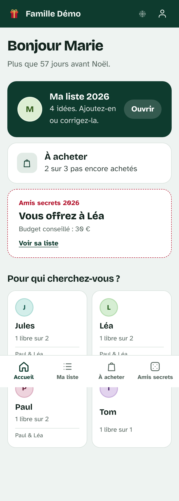
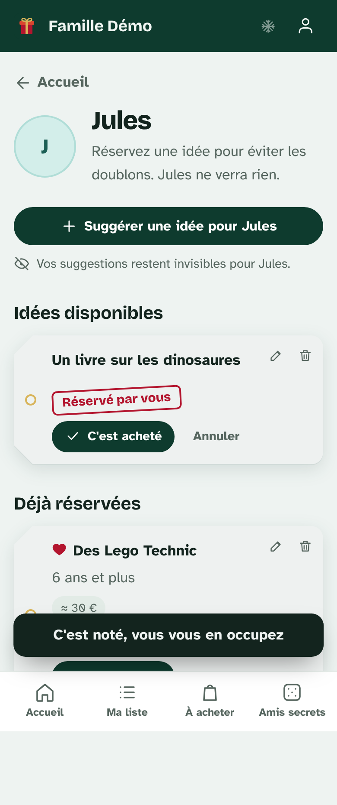
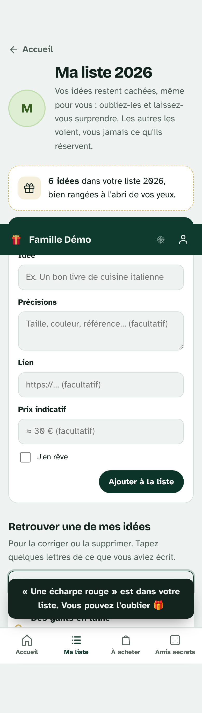
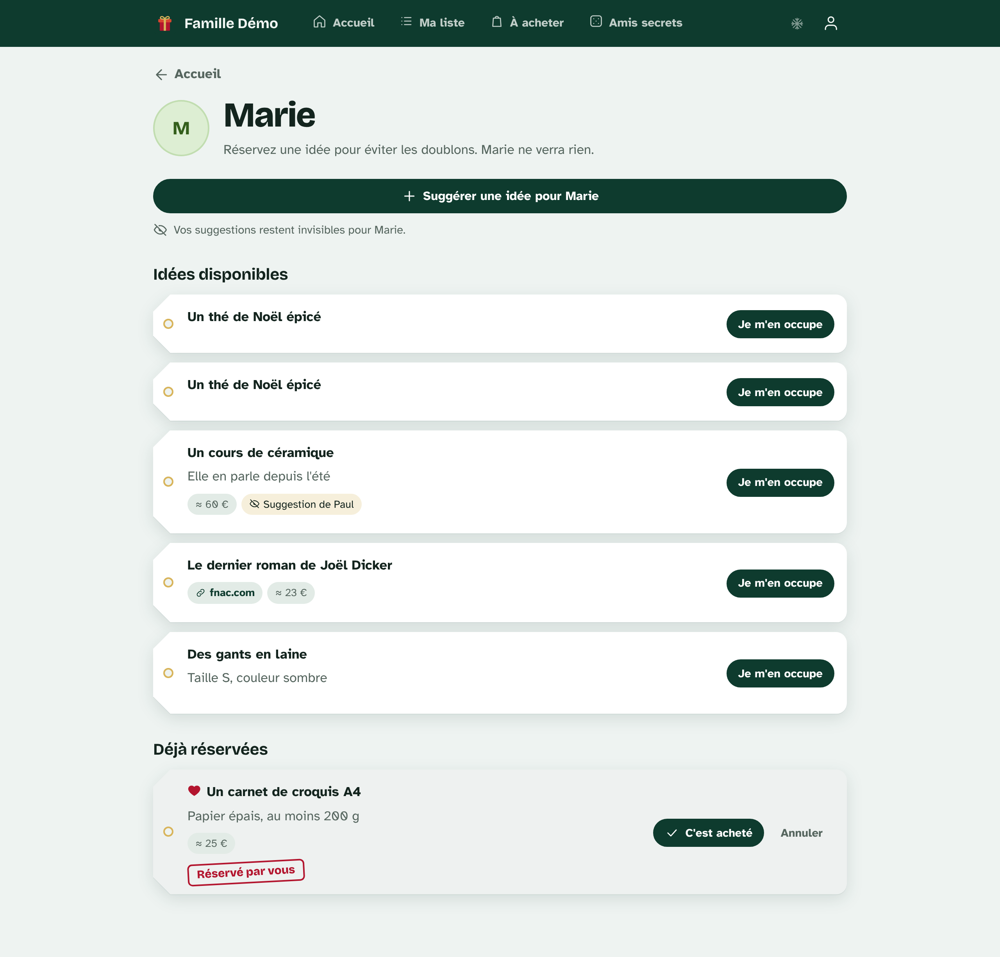

# 🎁 Cadeaux de Noël

La liste au Père Noël de toute la famille. Chacun écrit ce qui lui ferait plaisir, les autres réservent ce qu'ils offrent, et **la personne concernée ne voit jamais ce qu'on lui prépare**.

Ce projet remplace les anciens sites `Cadeaux`, `Cadeaux_mulhouse` et `Anniv_sim`. L'analyse de l'ancien site et les raisons des choix faits ici sont dans **[docs/ANALYSE.md](docs/ANALYSE.md)**.

## Ce que fait le site

- **Ma liste, cachée même pour soi** : on ajoute ses idées (précisions, lien, prix indicatif, cœur « j'en rêve ») puis on les oublie pour être surpris. Le site indique seulement combien on en a mis, et une **recherche** retrouve une idée pour la modifier ou la supprimer. Elle ne montre jamais les suggestions des autres ni les réservations.
- **Les listes des autres** : réserver (« Je m'en occupe »), marquer comme acheté, **participer à plusieurs** à un gros cadeau, ou **suggérer une idée**, marquée « Suggestion d'un tiers » et invisible pour la personne.
- **À acheter** : tout ce dont je m'occupe, avec une case à cocher une fois l'achat fait.
- **Années automatiques** : les idées non offertes des années passées restent proposées aux autres, et chacun peut retrouver les siennes et les « garder pour cette année ».
- **Amis secrets en 1, 2 ou 3 boucles** : chacun offre à 1, 2 ou 3 personnes différentes. Le tirage respecte les foyers et ne donne jamais deux fois la même personne. Si possible, il évite aussi les échanges réciproques, que deux personnes d'un même foyer offrent à la même personne, et les tirages de l'an dernier. Chacun ne voit que ses propres amis secrets.
- **« Toujours d'actualité ? »** : chaque année, on revoit ses idées non offertes : « Oui » les range de nouveau (cachées), « Modifier » permet de les corriger, « Non » les supprime.
- **Calendrier de l'Avent** : une case par jour, qui ne s'ouvre que le jour venu. L'organisateur envoie toutes les images d'un coup depuis le site.
- **Aperçu des liens** : l'image du produit apparaît automatiquement quand on colle un lien.
- **Plusieurs familles** sur un seul site, chacune avec son lien d'invitation.
- **Profils sans compte** (enfants, grands-parents) dont un parent tient la liste.
- **Gestion** pour les organisateurs : invitations, foyers, membres, lien « mot de passe oublié ».
- Pensé pour le téléphone, avec un thème clair aux couleurs de Noël et une neige qu'on peut couper.

## Technique

Django 5.2, HTMX (actions sans rechargement de page), CSS écrit à la main, SQLite et WhiteNoise. Aucune étape de compilation, aucune dépendance JavaScript externe, polices hébergées sur le site.

```
config/          réglages Django (lus depuis les variables d'environnement)
noel/
  models.py      Famille, Foyer, Membre, Idée, Réservation, Tirage, Attribution
  visibility.py  qui voit quoi : toutes les règles qui protègent la surprise
  secret_santa.py  algorithme du tirage au sort
  views.py, urls.py, forms.py
  templates/, static/
  management/commands/
    import_ancien_site.py   reprise des anciennes bases
    charger_avent.py        images du calendrier de l'Avent depuis un dossier
    demo.py                 famille fictive pour essayer
  preview.py     aperçu automatique des liens
  tests.py       37 tests
deploy/          service systemd et configuration nginx
```

## Essayer en local

```bash
python -m venv .venv && source .venv/bin/activate      # Windows : .venv\Scripts\activate
pip install -r requirements.txt
export DJANGO_DEBUG=1                                  # Windows : set DJANGO_DEBUG=1
python manage.py migrate
python manage.py demo          # comptes Marie / Paul / Léa / Tom, mot de passe « noel2026 »
python manage.py runserver
```

Ouvrez http://127.0.0.1:8000. Les tests se lancent avec `python manage.py test noel`.

## Reprendre les données de l'ancien site

La commande lit une base de l'ancien site, sans la modifier, et la range dans une famille. **Les comptes gardent leur mot de passe actuel.** Elle peut être relancée sans créer de doublons.

```bash
# Famille Jean : la base 2025, puis la sauvegarde 2023-2024 (pour récupérer aussi les tirages 2024)
python manage.py import_ancien_site Noel/Noel/Cadeaux/db.sqlite3 --famille "Famille Jean" --admin Edmond
python manage.py import_ancien_site Noel/base_sauvgarde/db_cadeaux_copie_2023_2024.sqlite3 --famille "Famille Jean" --annee-tirages 2024

# Calendrier de l'Avent (ou depuis le site : Calendrier → Préparer le calendrier)
python manage.py charger_avent Noel/Noel/Cadeaux/media/avent_images --famille "Famille Jean" --debut 2026-11-30

# Plus tard, si besoin : Mulhouse
python manage.py import_ancien_site Noel/Cadeaux_mulhouse/db_mulhouse.sqlite3 --famille "Mulhouse" --admin Edmond
```

Options utiles :

| Option | Effet |
|---|---|
| `--admin Edmond Isabelle` | Prénoms des organisateurs (gestion, tirages). |
| `--annee-defaut 2023` | Année des idées si l'ancienne base n'en enregistre pas (le cas de Mulhouse). |
| `--annee-tirages 2024` | Année des anciens tirages quand la base ne l'enregistre pas (bases d'avant 2025). |
| `--sans-tirages` | Ne pas reprendre les tirages (les anciens « essaie 1/2/3 », par exemple). |
| `--auteur-proprietaire` | Voir ci-dessous. |

**À propos des anciennes idées.** L'ancien site n'enregistrait pas qui avait écrit une idée. Par prudence, les idées reprises restent **invisibles pour la personne concernée**, comme avant. Les autres les voient toujours. Avec `--auteur-proprietaire`, chacun peut retrouver ses anciennes idées par la recherche et les garder pour cette année, mais il verra aussi les suggestions qu'on avait ajoutées pour lui.

Un prénom présent dans les deux bases (Edmond, par exemple) devient **un seul compte membre des deux familles**.

## Mettre en ligne

### Option A : sur le serveur actuel, sans Docker

```bash
git clone https://github.com/Obstraqueur/Cadeaux_de_Noel.git && cd Cadeaux_de_Noel
python3 -m venv .venv && .venv/bin/pip install -r requirements.txt
cp .env.example .env && nano .env           # clé secrète, adresse du site, GUNICORN_BIND=127.0.0.1:8000
set -a && . ./.env && set +a
mkdir -p data
.venv/bin/python manage.py migrate
.venv/bin/python manage.py collectstatic --noinput
.venv/bin/python manage.py import_ancien_site ../Cadeaux/db.sqlite3 --famille "Famille Jean" --admin Edmond
sudo cp deploy/cadeaux.service /etc/systemd/system/ && sudo systemctl enable --now cadeaux
sudo cp deploy/nginx.conf /etc/nginx/sites-available/cadeaux   # adapter le nom de domaine
sudo ln -s /etc/nginx/sites-available/cadeaux /etc/nginx/sites-enabled/ && sudo systemctl reload nginx
sudo certbot --nginx -d cadeaux.exemple.fr                     # HTTPS gratuit
```

Pour arrêter l'ancien site : `pkill -f "gunicorn.*Cadeaux"` (il tournait avec `nohup`).
Pour mettre à jour : `git pull && .venv/bin/python manage.py migrate && .venv/bin/python manage.py collectstatic --noinput && sudo systemctl restart cadeaux`.

> Sans nom de domaine ni HTTPS (accès par `http://IP:8000`), mettez `DJANGO_SECURE_COOKIES=0` dans `.env`, sinon la connexion échoue. Le HTTPS reste fortement conseillé : il protège les mots de passe.

### Option B : avec Docker

```bash
cp .env.example .env && nano .env
docker compose up -d --build
docker compose exec web python manage.py import_ancien_site /app/data/ancien.sqlite3 --famille "Famille Jean" --admin Edmond
```

(Copiez d'abord l'ancienne base dans le dossier `data/`.)

### Sauvegarde

Toutes les données sont dans le dossier `data/` : la base `cadeaux.sqlite3` et les images du calendrier dans `media/`. Copiez ce dossier de temps en temps.

## Premier lancement sans ancienne base

1. `python manage.py createsuperuser` (ou inscrivez-vous puis créez une famille depuis la page d'accueil).
2. Connectez-vous et créez votre famille : vous en êtes l'organisateur.
3. Dans **Gérer la famille**, copiez le lien d'invitation et envoyez-le sur le groupe familial.

## Captures (données fictives)

| Accueil | Réservation | Ma liste (cachée) |
|---|---|---|
|  |  |  |


