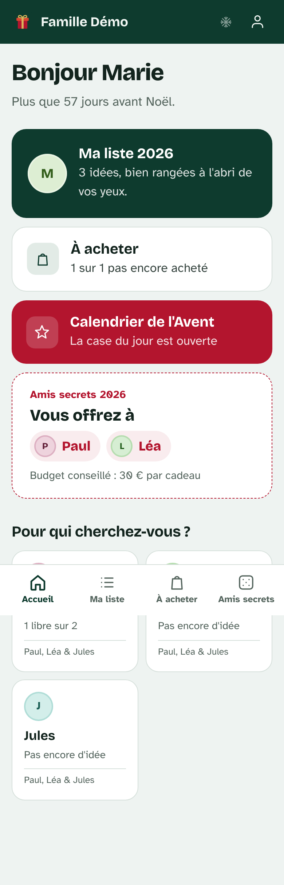
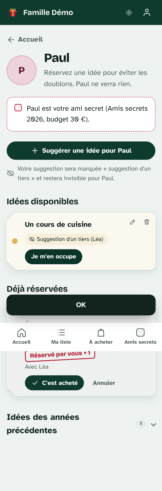
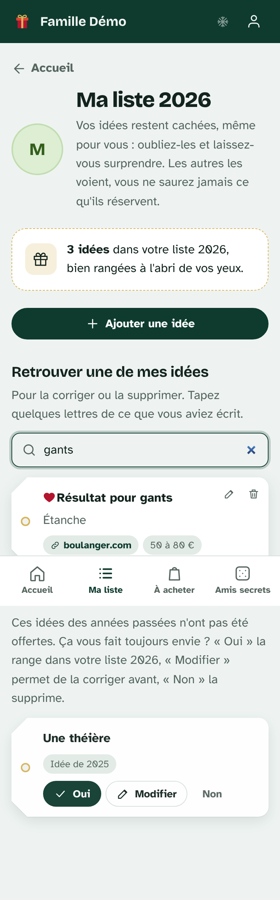
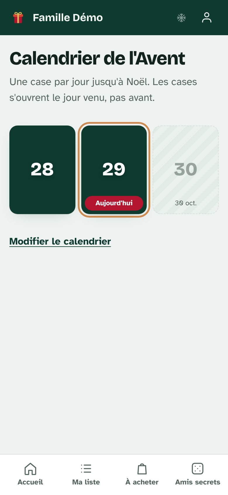

# 🎁 Cadeaux de Noël

La liste au Père Noël de toute la famille. Chacun écrit ce qui lui ferait plaisir, puis l'oublie. Les autres réservent ce qu'ils offrent, et **la personne concernée ne voit jamais ce qu'on lui prépare**.

- **Le site** : des pages fixes hébergées gratuitement par **GitHub Pages**.
- **Les données** : comptes, idées, réservations, tirages et calendrier, dans **Supabase** (gratuit), protégées par des règles de sécurité dans la base.

L'analyse de l'ancien site et les raisons des choix sont dans **[docs/ANALYSE.md](docs/ANALYSE.md)**. La version Django précédente est conservée dans la branche [`version-django`](../../tree/version-django).

## Ce que fait le site

- **Ma liste, cachée même pour soi** : on ajoute ses idées (précisions, lien, prix, cœur « j'en rêve ») puis on les oublie. Le site affiche seulement combien on en a mis, et une **recherche** retrouve une idée pour la corriger ou la supprimer.
- **« Toujours d'actualité ? »** : les idées non offertes des années passées s'affichent avec trois choix. « Garder » les range de nouveau (cachées), « Modifier » permet de les corriger, « Enlever » les retire.
- **Les listes des autres** :
  - réserver une idée (« Je m'en occupe »), puis la marquer comme achetée ;
  - **participer à plusieurs** à un même cadeau ;
  - **suggérer une idée**, marquée « Suggestion d'un tiers (prénom) » et invisible pour la personne concernée.
- **À acheter** : tout ce dont je m'occupe, avec une case à cocher.
- **Amis secrets en 1, 2 ou 3 boucles**, tirés sur le serveur (personne ne voit le résultat des autres) :
  - **toujours** : pas soi-même, pas son foyer, pas deux fois la même personne ;
  - **si possible** : pas la personne de l'an dernier, pas le même ami pour deux personnes d'un foyer, pas d'échange réciproque.
- **Calendrier de l'Avent** : une case par jour, qui ne s'ouvre que le jour venu. L'organisateur envoie toutes les images d'un coup.
- **Aperçu des liens** : l'image du produit s'affiche automatiquement.
- **Gestion** : lien d'invitation, foyers, profils sans compte (enfants), mot de passe provisoire en cas d'oubli.

## Mise en ligne (une seule fois)

### 1. Supabase : créer la base

1. Dans Supabase, ouvrez **SQL Editor → New query**.
2. Collez **tout** le fichier [`supabase/migrations/20261029120000_cadeaux_de_noel.sql`](supabase/migrations/20261029120000_cadeaux_de_noel.sql) et cliquez sur **Run**. Faites de même, dans l'ordre, avec les autres fichiers du dossier `supabase/migrations/`.
3. Dans **Authentication → Sign In / Providers → Email**, désactivez **« Confirm email »**.

Le script crée les tables, les règles de sécurité, les fonctions et l'espace de stockage privé « avent » pour les images du calendrier.

### 2. Supabase : reprendre les données de l'ancien site

Sur votre ordinateur (Python 3 suffit, rien à installer) :

```bash
python outils/import_ancien_site.py  Noel/Noel/Cadeaux/db.sqlite3  Noel/base_sauvgarde/db_cadeaux_copie_2023_2024.sqlite3 \
       --famille "Famille Jean" --admin Edmond  > import_famille_jean.sql
```

Collez le contenu de `import_famille_jean.sql` dans **SQL Editor** et cliquez sur **Run**. En fin de fichier se trouve le **code d'invitation** de la famille.

⚠️ Ce fichier contient les prénoms et les idées de la famille. **Ne le publiez pas** : il est exclu de git.

| Option | Effet |
|---|---|
| `--admin Edmond Isabelle` | Les organisateurs : ils gèrent la famille, les tirages et le calendrier. |
| `--auteur-inconnu` | Par défaut, chaque ancienne idée est attribuée à la personne de la carte : elle la retrouve dans « Toujours d'actualité ? ». Avec cette option, les anciennes idées restent cachées pour elle et sont marquées « suggestion d'un tiers ». |
| `--annee-defaut`, `--annee-tirages` | L'année des idées et des tirages, quand une base ancienne ne l'enregistre pas. |

### 3. GitHub Pages : mettre le site en ligne

Dans le dépôt GitHub : **Settings → Pages → Build and deployment → Source : « Deploy from a branch »**, puis **Branch : `main` / `(root)`** et **Save**. Au bout d'une à deux minutes, le site est en ligne à l'adresse **https://obstraqueur.github.io/Cadeaux_de_Noel/**.

### 4. Inviter la famille

Chacun ouvre le lien `https://obstraqueur.github.io/Cadeaux_de_Noel/#/invitation/<code>`, **choisit son prénom dans la liste** (ses idées et ses tirages sont déjà là) et choisit un mot de passe. **Commencez par Edmond** : ce compte devient organisateur. Ensuite, le lien est toujours disponible dans **Gérer la famille**.

Les mots de passe de l'ancien site ne peuvent pas être repris, car Supabase utilise un autre format.

### 5. Calendrier de l'Avent

Menu **Calendrier de l'Avent → Préparer le calendrier → Tout envoyer d'un coup**. Sélectionnez toutes les images (`day0.png`, `day0_modal.png`, `day1.png`…) et choisissez la date de la case 0 (le 30 novembre par défaut).

## Comment c'est construit

```
index.html                 la page unique du site
assets/
  app.css                  la direction artistique (étiquettes cadeaux, vert sapin, rouge houx)
  js/app.js                les écrans : listes, réservations, tirages, calendrier, gestion
  js/ui.js                 petits outils d'affichage
  js/config.js             adresse et clé PUBLIQUE de Supabase
  vendor/                  supabase-js (copié ici, sans dépendance externe)
  fonts/                   polices hébergées sur le site
supabase/
  migrations/…sql          tables, règles de sécurité, fonctions serveur
  tests/                   20 tests de sécurité de la base (Postgres local)
outils/import_ancien_site.py   reprise des anciennes bases
docs/ANALYSE.md            analyse critique de l'ancien site
```

**Sécurité.** La clé de `config.js` est publique par nature. Le navigateur ne peut que **lire** ce que les règles de la base autorisent, et toutes les modifications passent par des fonctions serveur qui vérifient les droits :
- la personne concernée ne peut pas lire les réservations sur ses idées, ni les suggestions des autres ;
- chacun ne lit que ses propres amis secrets ;
- les images du calendrier ne sont lisibles qu'à partir de leur jour.

**Aperçu des liens.** Il passe par le service gratuit [Microlink](https://microlink.io) : le lien collé lui est envoyé pour récupérer l'image. Pour le désactiver, mettez `LINK_PREVIEW = false` dans `assets/js/config.js`.

## Captures (données fictives)

| Accueil | Liste de quelqu'un | Ma liste (cachée) | Calendrier |
|---|---|---|---|
|  |  |  |  |
